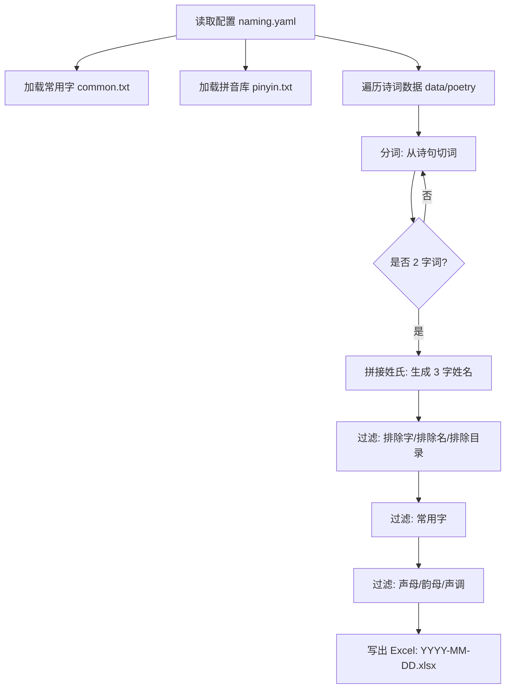

# child-naming

基于古诗词语料，为孩子生成中文姓名候选，并做一轮“可读性/发音和谐/避讳”筛选，最后导出到 Excel。

## 功能概览

- **数据来源**：`data/poetry/**.json`（唐诗/宋词等）、`data/common/common.txt`（常用字表）、`data/pinyin/pinyin.txt`（单字拼音+声调）
- **核心思路**：从诗句里分词，挑出 **2 个汉字** 作为名（加上姓氏组成 3 字姓名），再按配置和拼音规则过滤
- **输出**：默认生成 `YYYY-MM-DD.xlsx`（写在当前目录）

## 快速开始

### 1) 配置 `naming.yaml`

仓库根目录自带一个示例 `naming.yaml`，结构如下（字段含义见下节）：

```yaml
require:
  surname: 邝
exclude:
  words: 坟;刑;狱
  names: 刑狱
  dirs:
output:
  format: excel  # 输出文件格式（当前实现主要使用 excel）
  number: 5000   # 输出名字数量上限
```

### 2) 运行

```bash
go run .
```

运行时会打印加载进度与配置摘要，结束后在当前目录生成一个 Excel 文件，例如：`2025-12-12.xlsx`。

> 提示：程序会读取配置文件 `naming.yaml`。如果你的工作目录不是仓库根目录，可以用环境变量指定：
>
> - `CHILD_NAMING_CONF=/abs/path/to/naming.yaml`

## 配置说明（`naming.yaml`）

### require

- **surname**：姓氏（单字），例如 `黄/李/邝`。必须能在拼音库中找到，否则会直接报错退出。

### exclude

以下字段用 `;` 分隔：

- **words**：避用的“单字”（例如 `坟;刑;狱`），只要名字里出现就会剔除
- **names**：避用的“完整名”（不含姓氏的 2 字名），例如 `刑狱`
- **dirs**：排除的诗词目录名（对应 `data/poetry/` 下的子目录名），例如 `song` 表示不使用宋词语料

### output

- **format**：输出格式（当前实现主要使用 `excel`）
- **number**：最多输出多少条结果（程序会读管道流并在达到上限后停止写入）

## 数据说明

- `data/poetry/`：诗词 JSON 语料，按子目录分类（如 `tang/`、`song/`）
- `data/common/common.txt`：常用字列表（用于过滤“生僻字”）
- `data/pinyin/pinyin.txt`：单字拼音库，格式形如 `邝kuang4`（最后一位为声调 1~5）

## 过滤规则（当前实现）

生成候选姓名后，会依次做以下过滤：

1. **配置避讳**
   - 过滤命中 `exclude.names` 的 2 字名
   - 过滤名字中包含 `exclude.words` 的任一字
2. **常用字过滤**
   - 名字的两个字都必须在 `common.txt` 中
3. **拼音和谐过滤**
   - **声母**：相邻两个字的声母不能相同（例如 `wu wang` 这种会被过滤）
   - **韵母**：相邻两个字的韵母不能相同（避免连续押同韵）
   - **声调**：相邻两个字的声调不能相同（避免连读单调）

## 工作流程图



## 预期行为示例（3 个 case）

> 下面示例只描述“可验证的性质”，不会承诺固定输出某个具体名字（分词与语料会影响结果）。

1. **基础生成**
   - **输入**：`surname=邝`，`output.number=100`
   - **预期**：生成一个 `YYYY-MM-DD.xlsx`，最多 100 行数据；每个名字都是 3 个汉字
2. **目录排除**
   - **输入**：`exclude.dirs=song`
   - **预期**：输出的“来源”字段不会出现 `song` 目录对应的分类（只来自未排除的语料目录）
3. **拼音库缺失**
   - **输入**：`surname=𠮷`（或任意拼音库中不存在的姓）
   - **预期**：程序打印 “pinyin not find” 错误并退出，不生成输出文件

## 开发与测试

```bash
go test ./... -v
```

说明：

- `pkg/naming.Run()` / `output.SaveExcel()` 会 `os.Exit(0)`（设计上用于命令行执行后直接退出），因此对应的单测用 `t.Skip` 标注跳过。
